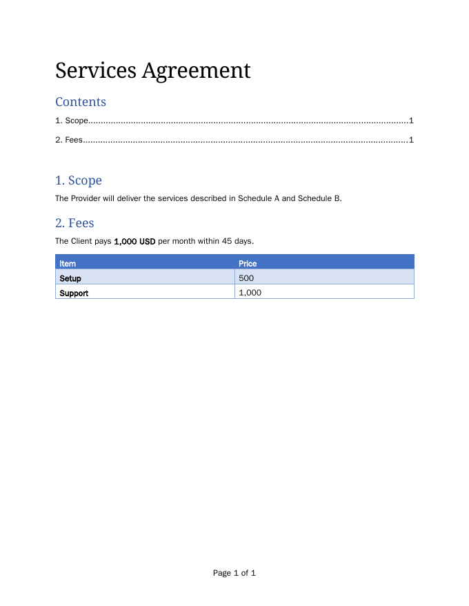

# docx-mcp

[](https://github.com/1ay1/docx-mcp/actions/workflows/ci.yml)

An MCP server that edits Word documents the way Word does.

Agents get 85 tools that cover the Word ribbon: text, formatting, styles,
lists, tables, pictures, headers and footers, fields, tables of contents,
footnotes, content controls, page setup, protection, and the whole
**Review** tab: Track Changes, accept and reject, threaded comments and
Compare.

Every file it writes is schema-valid and is checked against Microsoft's own
validator. Built in C++23 on [mcp-cpp](https://github.com/1ay1/mcp-cpp).
Nothing to install: every library is vendored or a submodule, and
`-DDOCX_STATIC=ON` builds one static binary of about 9 MB.

<p align="center"></p>
<p align="center"><sub>A contract drafted, reviewed with tracked changes and comments, then finalized, all through MCP calls (from <code>tests/e2e.py</code>).</sub></p>

## Why

Most docx libraries can write a paragraph. Few can do what a careful person
does in Word without leaving the file subtly broken:

- **Tracked changes that are real Word revisions.** Insertions, deletions,
  formatting changes, paragraph marks, table rows and cells, numbering and
  sections, all attributed to an author. They survive Word, and they accept
  and reject cleanly.
- **Comments the way Word 365 stores them**, with threads, replies and
  resolved state, across all five comment parts.
- **Word's built-in styles with Word's own definitions**, added only when
  first used, as Word does.
- **Correct structure.** Every element is written in schema order, ids are
  unique, namespaces and `mc:Ignorable` are kept consistent, and existing
  content in unknown namespaces is preserved.

## Quick start

Download the binary for your system from the
[latest release](https://github.com/1ay1/docx-mcp/releases/latest): Windows,
macOS (Apple silicon and Intel), or Linux (x64 and arm64). It's one file with
nothing to install. Or build it:

```sh
git clone --recursive https://github.com/1ay1/docx-mcp
cd docx-mcp
cmake -S . -B build -G Ninja -DCMAKE_BUILD_TYPE=Release
cmake --build build
```

Add it to your MCP client (setup for Claude Desktop, Claude Code, Cursor,
VS Code, Windsurf, Zed and others is in [docs/clients.md](docs/clients.md)):

```json
{
  "mcpServers": {
    "docx": { "command": "/path/to/docx-mcp/build/docx-mcp", "args": ["--author", "Your Name"] }
  }
}
```

Then ask your agent things like:

- "Open `contract.docx`, turn on Track Changes, change the payment term to 45 days and leave a comment explaining why."
- "Accept all of Bob's changes except the formatting ones."
- "Compare `v1.docx` and `v2.docx` and save the result as `redline.docx`."
- "Add a table of contents, make the section titles Heading 1, and put 'Page X of Y' in the footer."

## A session

```text
open_document     {"path": "contract.docx", "author": "Bob"}               -> {"doc": "doc1", ...}
read_document     {"doc": "doc1"}                                          -> paragraphs with stable ids
set_track_changes {"doc": "doc1", "on": true}
replace_text      {"doc": "doc1", "paragraph": "3F2A10C4", "match": "30 days", "text": "45 days"}
add_comment       {"doc": "doc1", "paragraph": "3F2A10C4", "match": "45 days", "text": "Our standard is 45."}
list_revisions    {"doc": "doc1"}                                          -> deletion + insertion by Bob
save_document     {"doc": "doc1"}
```

## Tools

| Area | Tools |
|---|---|
| Documents | `open_document` `create_document` `save_document` `close_document` `list_open_documents` `undo` |
| Reading | `read_document` `get_text` `get_outline` `get_paragraph` `find_text` `get_statistics` |
| Editing | `insert_text` `replace_text` `delete_text` `find_replace` `insert_paragraph` `delete_paragraph` `split_paragraph` `merge_paragraphs` `move_paragraphs` |
| Formatting | `format_text` `format_paragraph` `apply_style` `clear_formatting` |
| Styles | `list_styles` `get_style` `modify_style` `delete_style` |
| Lists | `apply_list` `set_list_level` `remove_list` `restart_numbering` |
| Review | `set_track_changes` `list_revisions` `accept_revisions` `reject_revisions` `compare_documents` |
| Comments | `add_comment` `list_comments` `reply_comment` `resolve_comment` `edit_comment` `delete_comment` |
| Tables | `insert_table` `read_table` `set_cell` `table_rows` `table_columns` `merge_cells` `format_table` `delete_table` |
| Insert | `insert_picture` `insert_break` `insert_hyperlink` `add_bookmark` `insert_note` `insert_field` `insert_toc` `insert_equation` `add_content_control` and their list/delete partners |
| Layout | `get_page_setup` `set_page_setup` `set_header_footer` `read_header_footer` `remove_header_footer` |
| File | `get_properties` `set_properties` `get_settings` `set_settings` `protect_document` `unprotect_document` |
| Expert | `validate_document` `get_xml` `set_paragraph_xml` |

Every argument is listed in [docs/tools.md](docs/tools.md).

## Works with any model

The server is built for the way models actually call tools:

- **Forgiving arguments.** Numbers and booleans sent as strings, a single id
  where a list is expected, objects sent as JSON text, enum values in any
  case (`"Center"`), camelCase or snake_case names, and common aliases
  (`old_text`/`new_text`, `document`, `file_path`) are all accepted.
- **Errors that say how to fix the call.** Unknown arguments list the valid
  ones. A bad document handle lists the open documents. A missing argument
  names it and describes it.
- **Profiles for small contexts.** `--tools core` exposes 32 tools (about 7.5k
  tokens of schema) instead of 85.
- **Protocol robustness.** It supports MCP versions 2024-11-05 through the
  current one, handles JSON-RPC batches, UTF-8 BOMs and CRLF, and survives
  malformed input. It never writes anything but protocol frames to stdout.

`tests/sloppy.py` checks all of this against the real binary.

## Cross-platform

Linux, macOS and Windows, x64 and arm64. CI builds and runs the full test
suite on each (GCC, AppleClang/libc++, MSVC) and publishes the binaries.
Paths with spaces, non-ASCII names, `~`, `file://` URIs and Windows drive
letters all work. Saving is atomic and durable (fsync before the rename) on
every platform.

## How we know it's right

Each output is checked by three independent consumers:

1. **Our validator**, generated from the Open XML SDK's schema data: 4,315
   element types and 397 semantic rules. On the 564 corpus files it reports
   exactly what Microsoft's validator reports (83 of 83, same locations).
2. **Microsoft's Open XML SDK validator** (`tools/oxval`), targeting Microsoft 365.
3. **LibreOffice**, which opens each file, counts revisions and comments, and renders it.

Files Word itself wrote with schema faults (named colours, smart tags, Word's
form of math revisions, ...) are repaired on open, so even those come out
valid.

And the behaviour is checked against Word's:

| Check | Result |
|---|---|
| Accept/reject vs. Word's expected output | 104 / 104 |
| Compare round-trips (WmlComparer corpus) | 29 / 29 |
| Password hash vs. a file protected in Word | verified |
| Edit battery, accept and reject on every corpus file: SDK errors | 0 in 2,256 outputs |
| All 85 tools, tracked and untracked, on real documents: SDK errors | 0 |

Details in [docs/conformance.md](docs/conformance.md).

## Docs

- [Clients](docs/clients.md): setup for every MCP client on Windows, macOS and Linux
- [Guide](docs/guide.md): workflows, addressing paragraphs, Track Changes, comments, formatting
- [Tool reference](docs/tools.md): every tool and argument
- [Conformance](docs/conformance.md): how output is verified, and where we differ from Word on purpose
- [Architecture](docs/architecture.md): how the engine is put together

## Limits

- Page numbers in a TOC and `PAGE`/`NUMPAGES` results depend on page layout.
  The fields are written correctly and Word refreshes them on open, but the
  server doesn't paginate.
- Not yet: charts, SmartArt and shape editing, floating (anchored) pictures,
  mail merge, VBA, and password-encrypted files.

## Tests

```sh
cd build/tests
./edit_test && ./comments_test && ./structure_test && ./docops_test
./revisions_corpus ../../tests/corpus/oxpt/RP
./robustness ../../tests/corpus
python3 ../../tests/e2e.py ../docx-mcp /tmp/e2e
python3 ../../tests/sloppy.py ../docx-mcp /tmp/sloppy
python3 ../../tests/coverage.py ../docx-mcp /tmp/cov
```

The external checks are optional. Build oxval with
`dotnet build -c Release -o /tmp/oxval-bin` in `tools/oxval`. The LibreOffice
checks need `soffice` with python3-uno.

## License

MIT. Third-party components and test files are listed in [THIRD_PARTY.md](THIRD_PARTY.md).
